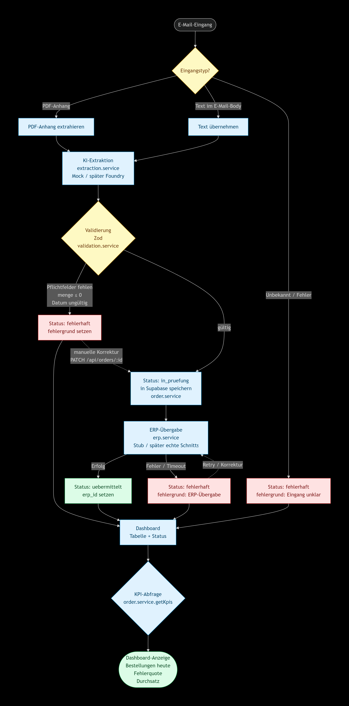

# Automatisierter Bestelleingangsprozess (Proof of Concept)

Proof of Concept für die **Handels GmbH** zur automatisierten Annahme, Extraktion, Validierung und ERP-Übergabe eingehender Kundenbestellungen inklusive Monitoring-Dashboard.

## Inhaltsverzeichnis

- [Automatisierter Bestelleingangsprozess (Proof of Concept)](#automatisierter-bestelleingangsprozess-proof-of-concept)
  - [Inhaltsverzeichnis](#inhaltsverzeichnis)
  - [1. Überblick \& Architektur](#1-überblick--architektur)
    - [Ordnerstruktur (Auszug)](#ordnerstruktur-auszug)
  - [2. Prozessmodell \& Anforderungsklärung](#2-prozessmodell--anforderungsklärung)
  - [3. Tech-Stack](#3-tech-stack)
  - [4. Projekt lokal starten](#4-projekt-lokal-starten)
    - [Voraussetzungen](#voraussetzungen)
    - [Schritt 1: Repository klonen \& Abhängigkeiten installieren](#schritt-1-repository-klonen--abhängigkeiten-installieren)
    - [Schritt 2: Supabase-Datenbank \& Demo-Benutzer einrichten](#schritt-2-supabase-datenbank--demo-benutzer-einrichten)
    - [Schritt 3: Umgebungsvariablen konfigurieren](#schritt-3-umgebungsvariablen-konfigurieren)
    - [Schritt 4: Anwendung \& Tests starten](#schritt-4-anwendung--tests-starten)
  - [5. Getroffene Annahmen \& Architekturentscheidungen](#5-getroffene-annahmen--architekturentscheidungen)
  - [6. Ausblick: Azure Deployment, CI/CD \& Microsoft Foundry](#6-ausblick-azure-deployment-cicd--microsoft-foundry)
    - [Deployment \& CI/CD in Azure](#deployment--cicd-in-azure)
    - [Echte Integration von Microsoft Foundry zur Dokumentklassifizierung](#echte-integration-von-microsoft-foundry-zur-dokumentklassifizierung)
  - [7. Persönliche Reflexion](#7-persönliche-reflexion)

---

## 1. Überblick & Architektur

Die Anwendung bildet die vollständige Prozesskette von der simulierten Bestellannahme bis zur Überwachung im Dashboard ab:

1. **Datenannahme (`POST /api/orders`):** Nimmt eine neue (Mock-)Bestellung entgegen und ruft den `extraction.service` auf.
2. **Validierung (`validation.service`):** Prüft alle Pflichtfelder über ein zentrales Zod-Schema (`kundenname`, `artikelnummer`, `menge > 0`, `bestelldatum`).
   - Ungültige Datensätze werden mit Status `fehlerhaft` und einem konkreten `fehlergrund` protokolliert.
   - Gültige Datensätze werden zunächst als `in_pruefung` in PostgreSQL (Supabase) persistiert.
3. **ERP-Übergabe (`erp.service`):** Bei Standardbestellungen erfolgt direkt die (als Stub implementierte) Übergabe an das ERP-System (`status = 'uebermittelt'`, Vergabe einer `erp_id`). Großbestellungen verbleiben zur manuellen Freigabe auf `in_pruefung`.
4. **Manuelle Nachbearbeitung (`PATCH /api/orders/[id]`):** Fehlerhafte oder zur Prüfung markierte Bestellungen können im Dashboard unter `/orders/[id]` korrigiert, erneut validiert und an das ERP übermittelt werden.
5. **Monitoring-Dashboard (`/dashboard`):** Geschützt via Supabase Auth; zeigt aggregierte KPIs (_Bestellungen heute_, _Fehlerquote_, _In Prüfung_, _An ERP übermittelt_) sowie alle Bestellungen inkl. Statusfilter.

### Ordnerstruktur (Auszug)

```text
├── docs/
│   ├── fragenkatalog.md              # Strukturierte Rückfragen an den Kunden
│   └── prozessdiagramm.png          # End-to-End-Prozessmodellierung
├── supabase/migrations/
│   ├── 001_initial_schema.sql       # Tabelle bestellungen, Constraints, Trigger, RLS & Grants
│   └── 002_seed_data.sql            # Initiale Beispieldaten für alle Prozessstatus
└── src/
    ├── env.ts                       # SvelteKit-3-Env-Validierung via Zod
    ├── hooks.server.ts              # Supabase SSR Session-Handling & zentraler Route-Guard
    ├── lib/
    │   ├── components/              # Wiederverwendbare UI-Komponenten (KPIs, Tabelle, Badges)
    │   ├── server/
    │   │   ├── schemas/             # Zod-Validierungsschemas
    │   │   ├── services/            # extraction, validation, order, erp (+ Vitest Unit-Tests)
    │   │   └── supabase.admin.ts    # Isolierter Service-Role-Client (ohne Cookie-Session)
    │   └── types/                   # End-to-End TypeScript- & Datenbanktypen
    └── routes/
        ├── (auth)/login/            # Login-Seite (E-Mail & Passwort)
        ├── (app)/dashboard/         # Geschütztes Monitoring-Dashboard
        ├── (app)/orders/[id]/       # Detail- & Korrekturansicht inkl. Rohdaten-Audit
        └── api/orders/              # REST-Endpunkte (POST, PATCH)
```

---

## 2. Prozessmodell & Anforderungsklärung

- **Rückfragen an den Kunden:** [`docs/fragenkatalog.md`](docs/fragenkatalog.md)
- **Prozessdiagramm (ab E-Mail-Eingang bis Dashboard):**



---

## 3. Tech-Stack

- **Frontend & Server-Backend:** SvelteKit 3 (Svelte 5 Runes), TypeScript (strict), Tailwind CSS v4, Lucide Icons
- **Validierung:** Zod v4 (Schema-Validierung & Env-Prüfung)
- **Datenbank & Auth:** Supabase (PostgreSQL, Row Level Security, Supabase SSR Auth)
- **Qualitätssicherung:** Vitest (Unit-Tests für Kernlogik), ESLint (strikte TypeScript-Regeln), Prettier, `svelte-check`

---

## 4. Projekt lokal starten

### Voraussetzungen

- Node.js (v20+ empfohlen; entwickelt mit Node v26)
- Ein kostenloses Supabase-Projekt

### Schritt 1: Repository klonen & Abhängigkeiten installieren

```bash
git clone <REPOSITORY-URL>
cd bestellprozess
npm install
```

### Schritt 2: Supabase-Datenbank & Demo-Benutzer einrichten

1. Im Supabase-Dashboard den **SQL Editor** öffnen und nacheinander ausführen:
   - `supabase/migrations/001_initial_schema.sql`
   - `supabase/migrations/002_seed_data.sql` _(optional für initiale Beispieldaten)_
2. Unter **Authentication → Users → Add user** einen Testbenutzer anlegen (mit aktiviertem _Auto Confirm User_).

### Schritt 3: Umgebungsvariablen konfigurieren

```bash
cp .env.example .env
```

Anschließend in `.env` die Werte aus **Supabase → Project Settings → API Keys** eintragen:

```env
PUBLIC_SUPABASE_URL=https://<projekt-id>.supabase.co
PUBLIC_SUPABASE_ANON_KEY=<publishable-oder-anon-key>
SUPABASE_SERVICE_ROLE_KEY=<secret-oder-service-role-key>
```

### Schritt 4: Anwendung & Tests starten

```bash
# Typcheck, Linting & Unit-Tests ausführen
npm run prepare
npm run check
npm run lint
npx vitest run --project server

# Entwicklungsserver starten
npm run dev
```

Die Anwendung ist anschließend unter `http://localhost:5173` erreichbar.

---

## 5. Getroffene Annahmen & Architekturentscheidungen

1. **Integriertes SvelteKit-Backend statt separatem Python-Dienst:**
   Für einen kompakten, wartbaren PoC laufen API-Routen und Business-Services direkt in SvelteKit-Servermodulen (`src/lib/server/services/`). Durch das gekapselte Service-Design (`ExtractionService`, `ErpService`) lassen sich einzelne Bausteine später problemlos in dedizierte Microservices auslagern.
2. **E-Mail/Passwort-Auth statt Magic-Link:**
   Um beim Testen und Demonstrieren des PoC unabhängig von Mail-Zustellung und Free-Tier-Rate-Limits bei Supabase zu bleiben, wurde E-Mail/Passwort gewählt. Im Produktivbetrieb würde Supabase Auth per OIDC an **Microsoft Entra ID** gekoppelt.
3. **Strikt getrennte Supabase-Clients (RLS + Service Role):**
   Lesezugriffe im Dashboard laufen über den Cookie-gebundenen User-Client (`locals.supabase`) unter aktiver Row Level Security (`authenticated read`). Schreibvorgänge aus den Server-Services laufen isoliert über `supabaseAdmin` (ohne Session-Persistenz), sodass auch künftige automatisierte Hintergrund-Worker ohne Benutzer-Session schreiben können.
4. **Vereinfachtes Datenmodell (1 Bestellung = 1 Artikel):**
   Für den PoC ist ein Auftrag flach in `public.bestellungen` modelliert. Für produktive Mehrpositions-Bestellungen wäre eine normalisierte `bestellpositionen`-Tabelle (1:n) erforderlich (im `fragenkatalog.md` adressiert).
5. **Fehlertolerante DB-Constraints:**
   Da fehlerhafte Extraktionen bewusst persistiert und im Dashboard korrigierbar sein sollen, greifen strikte Pflichtfeld-Checks auf Datenbankebene (`chk_vollstaendig_wenn_nicht_fehlerhaft`) nur für Datensätze mit Status ungleich `fehlerhaft`.

---

## 6. Ausblick: Azure Deployment, CI/CD & Microsoft Foundry

### Deployment & CI/CD in Azure

- **Hosting:** Deployment der SvelteKit-App über `@sveltejs/adapter-node` in **Azure Container Apps** (alternativ Azure App Service oder Azure Static Web Apps).
- **Secrets & Konfiguration:** Verwaltung von `SUPABASE_SERVICE_ROLE_KEY`, ERP-Credentials und Foundry-API-Keys über **Azure Key Vault** bzw. Environment Variables der Container App.
- **CI/CD-Pipeline (GitHub Actions):**
  1. Bei jedem Pull Request / Push auf `main`: `npm ci`, `npm run prepare`, `npm run check`, `npm run lint`, `npm run test` und `npm run build`.
  2. Datenbank-Migrationen (`supabase/migrations/`) automatisiert über die Supabase CLI prüfen und ausrollen.
  3. Docker-Image bauen, in die **Azure Container Registry (ACR)** pushen und ein Zero-Downtime-Revision-Update auf **Azure Container Apps** auslösen.

### Echte Integration von Microsoft Foundry zur Dokumentklassifizierung

Das definierte Interface `ExtractionService` (`src/lib/server/services/extraction.service.ts`) ist bereits auf Austauschbarkeit ausgelegt:

1. **E-Mail-Ingress:** Eine **Azure Logic App** (oder Microsoft Graph Webhook) überwacht das Bestellpostfach, legt eingehende PDFs/E-Mails in **Azure Blob Storage** ab und stößt eine **Azure Function** an.
2. **Klassifizierung & Extraktion mit Microsoft Foundry:**
   - Ein Klassifizierungs-Schritt prüft zuerst, ob es sich überhaupt um eine Bestellung handelt (vs. Rechnung, Rückfrage, Spam).
   - Anschließend extrahiert **Azure AI Document Intelligence** (Layout/Text) kombiniert mit einem über **Microsoft Foundry** bereitgestellten Modell via **Structured Outputs (JSON Schema)** die Zielfelder (`kundenname`, `artikelnummer`, `menge`, `bestelldatum`, `lieferadresse`) inklusive **Confidence-Score**.
3. **Human-in-the-Loop:** Liegt der Confidence-Score unter einem definierten Schwellwert (z. B. `< 0.85`) oder schlägt die Zod-Validierung fehl, landet der Datensatz automatisch mit `in_pruefung` bzw. `fehlerhaft` im Dashboard zur manuellen Freigabe.

---

## 7. Persönliche Reflexion

- **Was lief gut:**
  Die frühe Trennung in klare Schichten (Zod-Schema, austauschbare Service-Interfaces, zentrale `hooks.server.ts`-Guards und strikte TypeScript-Typen für Supabase) hat zu einer sehr sauberen, wartbaren Codebasis ohne `any`-Workarounds geführt. Der End-to-End-Datenfluss – inklusive Fehlerfall und manueller Korrektur über das Dashboard – ließ sich dadurch zügig und nachvollziehbar umsetzen.
- **Herausforderungen:**
  1. _Datenbank-Constraints vs. Fehlerprotokollierung:_ Im ersten Schema-Entwurf hätten strikte `NOT NULL`- und `menge > 0`-Constraints verhindert, dass fehlerhafte Extraktionen überhaupt gespeichert werden können. Das bedingte Check-Constraint (`chk_vollstaendig_wenn_nicht_fehlerhaft`) hat diesen Konflikt sauber gelöst.
  2. _Supabase RLS & PostgreSQL-Rechte:_ Beim ersten Lesezugriff trat trotz RLS-Policy ein `permission denied`-Fehler auf, weil der Rolle `authenticated` explizite SQL-`GRANT SELECT`-Rechte fehlten – ein wichtiges Detail bei reinen SQL-Migrationen.
  3. _SvelteKit 3 & striktes ESLint:_ Durch den Einsatz der aktuellen SvelteKit-3-Konventionen (`src/env.ts`, `resolve()`, `refreshAll()`, `Response.json()`) und strenger `no-unsafe-*`-Linting-Regeln musste die `Database`-Typisierung exakt als `type` definiert werden, damit Supabase-Abfragen durchgehend typsicher bleiben.
- **Was ich in einem echten Kundenprojekt anders machen würde:**
  - Erweiterung des Datenmodells um `bestellpositionen` (1:n) und ein Idempotenz-Konzept (`message_id` / Inhalts-Hash) gegen doppelte E-Mails.
  - Asynchrone Verarbeitung über eine Message Queue (z. B. Azure Service Bus) mit automatischen Retries und Dead-Letter-Handling für temporäre ERP-Ausfälle.
  - Vollständige End-to-End-Tests mit Playwright sowie strukturierte Audit-Logs und rollenbasierte Zugriffskontrolle (RBAC) über Microsoft Entra ID.
